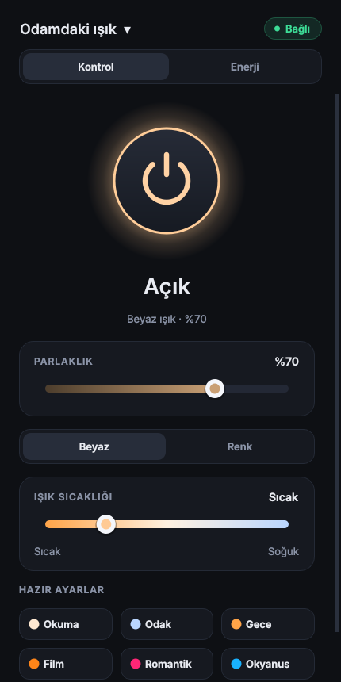
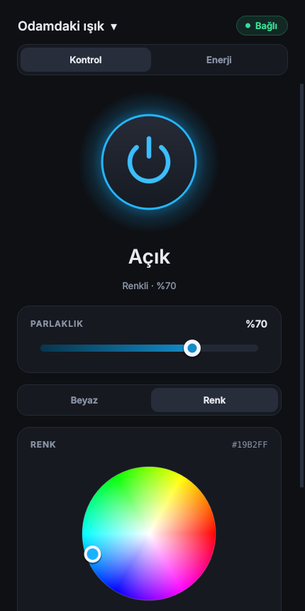
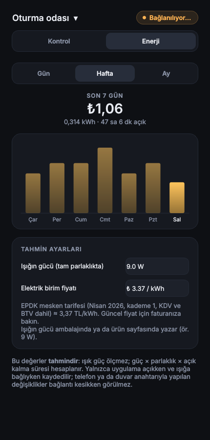
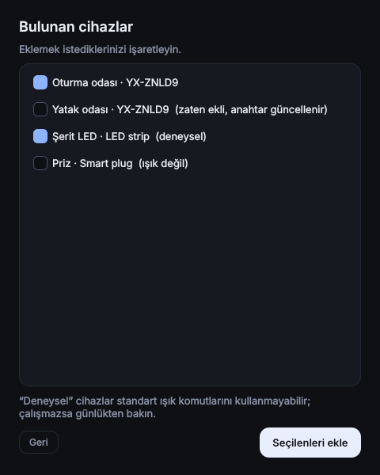

# Odamdaki Işık

Tuya / Smart Life ışıklarını bilgisayardan **Bluetooth ile** kontrol eden, internetsiz çalışan
masaüstü uygulaması. Açma/kapama, parlaklık, beyaz ışık sıcaklığı, renk ve hazır ayarlar;
birden çok ışık, sistem tepsisi ve **tahmini enerji/maliyet (TL)** sekmesi.

<p align="center">
  
  
  
  
</p>

> **Resmi olmayan bir projedir.** Tuya Inc. ile bağı yoktur. "Tuya" ve "Smart Life" ilgili
> sahiplerinin ticari markalarıdır. Yazılım olduğu gibi sunulur (bkz. [LICENSE](LICENSE)).

## Durum (dürüst özet)

| | |
|---|---|
| Bluetooth (BLE) bağlantısı ve el sıkışma | Gerçek bir ışıkla (Tuya `dj` kategorisi, YX-ZNLD9) denendi, çalışıyor |
| Komutlar (aç/kapat, parlaklık, renk…) ve arayüz | Testlerle doğrulandı; **gerçek ışıkta uçtan uca doğrulama sürüyor** |
| Windows 10/11 | Birincil hedef. Arayüzün gerçek Windows'ta geniş denemesi henüz yok |
| macOS / Linux | Çalışması beklenir (Qt + bleak), denenmedi |
| Wi-Fi (yerel ağ) kontrolü | **Henüz yok** (planlı, aşağıya bakın) |
| Diğer ışık modelleri | Standart `dj` komut setini kullananların çalışması beklenir. Denediyseniz bir "issue" açıp modeli yazın |

## Kurulum

### Hazır sürüm (Windows)
[Sürümler](../../releases) sayfasından `OdamdakiIsik-windows.zip` dosyasını indirip çıkarın ve
`OdamdakiIsik.exe`'yi çalıştırın. (Windows SmartScreen "bilinmeyen yayıncı" diyebilir: imzalı değildir.)

### Kaynaktan
Python 3.12+ gerekir.

```
python -m pip install -r requirements.txt
python light_app.py
```

Windows'ta kolay yol: `kur.ps1` (sanal ortamı kurar), sonra `baslat.bat` ya da `kisayol_olustur.ps1`.
Kendi `.exe`'nizi derlemek için: `build_exe.ps1`.

## İlk kullanım: ışık anahtarı

Bir Tuya ışığını Bluetooth ile yönetmek için ışığa özel bir **yerel anahtar** gerekir. Bu anahtarı
yalnızca ışığın bağlı olduğu Tuya hesabı verebilir; **bir kez** alınır, sonra uygulama internetsiz çalışır.
Uygulama ilk açılışta sizi yönlendirir:

1. [iot.tuya.com](https://iot.tuya.com)'da ücretsiz hesap açıp bir *Cloud Project* oluşturun
   (Smart Home; bulunduğunuz bölgenin veri merkezi).
2. Projenin *Overview* sayfasından **Access ID** ve **Access Secret**'ı kopyalayın.
3. Projede *Devices → Link App Account* ile Smart Life uygulamanızı QR kodla bağlayın.
4. Uygulamadaki sihirbaza Access ID/Secret'ı yapıştırın; hesabınızdaki ışıklar ve anahtarları gelir.
   Access Secret **hiçbir yere kaydedilmez**.

Anahtarı başka bir yolla zaten biliyorsanız sihirbazda "elle gir" seçeneği var.

> Smart Life uygulamasında QR ile giriş (geliştirici hesabı gerektirmeyen yol) planlı ama şimdilik yok:
> Tuya'nın bu giriş için verdiği istemci kimliği Home Assistant'a özeldir ve üçüncü taraf
> uygulamaların ödünç almaması gerekir. Tuya'dan kendi kimliğimizi alabilirsek eklenecek.

## Kullanım

* **Işık değiştirme / ekleme / kaldırma:** pencere başlığındaki ışık adına tıklayın.
* Pencereyi kapatınca uygulama **sistem tepsisine** iner; tepsiden ışığı açıp kapatabilirsiniz.
* Bağlantı koparsa kendiliğinden yeniden bağlanır.
* **Telefondaki Smart Life'ın Bluetooth'u kapalı olmalı:** BLE'de ışığa aynı anda tek cihaz bağlanır.
* Birden çok ışık: aynı modelden ışıklar birbirinden reklamla ayırt edilemeyebilir; uygulama en yakın
  adayları sırayla dener ve doğru anahtarı kabul edeni seçer.

## Enerji sekmesi (tahmini tüketim ve TL)

*Enerji* sekmesi günlük (saatlik çubuklar), haftalık (son 7 gün) ve aylık (son 30 gün) tahmini tüketimi
kWh ve TL olarak gösterir.

* Işık anlık güç **ölçmez**. Hesap: ışığın gücü (W) × parlaklık oranı × açık kalma süresi.
  Işığın gücünü (ambalajda yazar, ör. 9 W) ve birim fiyatı sekmeden ayarlarsınız.
* Süre yalnızca **uygulama açıkken ve ışığa bağlıyken** kaydedilir. Telefon ya da duvar anahtarıyla
  yapılan değişiklikler bağlantı kesikken görülmez; yani değerler gerçeğin alt sınırına yakın bir tahmindir.
* Varsayılan fiyat 3,37 TL/kWh: EPDK mesken tarifesi, 4 Nisan 2026, kademe 1 (aylık 240 kWh'e kadar,
  2,92 TL/kWh) KDV %10 ve BTV %5 ile. Tarifeler çeyrek dönemlerde değişebilir, bu yüzden **faturanızdaki
  değeri girin**. Kademe 2 (240 kWh üstü) hesaba katılmaz; bir ışık bu limite yaklaşmaz.
* Kayıtlar `energy.db` dosyasında, anahtarlarla aynı klasörde tutulur.

## Gizlilik ve güvenlik

* Işıklarınızın yerel anahtarları **yalnızca bu bilgisayarda** saklanır: Windows'ta
  `%APPDATA%\OdamdakiIsik\devices.json` (macOS: `~/Library/Application Support`, Linux: `~/.config`).
  Dosya yalnızca sizin kullanıcınıza açılır ama şifrelenmez; **paylaşmayın, depoya yüklemeyin.**
* Enerji kayıtları da yalnızca bu bilgisayarda tutulur. Uygulama bir sunucuya veri göndermez. İnternet yalnızca kurulum sihirbazında Tuya Cloud'a bağlanırken kullanılır.
* Yerel anahtarı bilen biri, Bluetooth menzilindeyse ışığı kontrol edebilir.

## Sorun giderme

| Belirti | Olası neden / çözüm |
|---|---|
| "Işık bulunamadı" | Bluetooth kapalı, ışık uzakta ya da **telefon ışığa bağlı**. Telefonun Bluetooth'unu kapatın. |
| "Işık anahtarı reddetti" | Anahtar eski (ışığı Smart Life'tan silip yeniden eklediyseniz değişir): *Işık ekle…* ile yeniden alın. |
| "Işık el sıkışmaya yanıt vermedi" | Anahtar yanlış ya da cihaz bu BLE protokolünü desteklemiyor (hem Wi-Fi hem Bluetooth'lu her cihaz desteklemez). |
| Bağlanıyor ama ışık tepki vermiyor | *Günlük* düğmesini açıp hataya bakın. DP numaraları farklı olabilir (standart: `switch_led=20`, `work_mode=21`, `bright_value_v2=22`, `temp_value_v2=23`, `colour_data_v2=24`). Sihirbaz bunları cihazın gerçek özelliklerinden okur; "deneysel" işaretli cihazlar farklı komut seti kullanabilir. |
| Sihirbaz: "Access ID veya Secret yanlış" | Değerleri yeniden kopyalayın (yapıştırırken karakter kaybolabilir) ve doğru veri merkezini seçin. |
| Sihirbaz: "Bu projeye bağlı cihaz bulunamadı" | Projede *Devices → Link App Account* adımı yapılmamış. |

## Geliştirme

```
python -m pip install -r requirements-dev.txt
python -m pytest tests          # ışık gerekmez; Qt "offscreen" modunda çalışır
python app.py scan              # çevredeki Tuya BLE cihazlarını listeler
```

Yapı: `light_core.py` (BLE oturumu, komut kodlama), `devices.py` (ışık deposu),
`cloud_import.py` (Tuya Cloud'dan içe aktarma), `ui/` (PySide6 arayüzü), `light_app.py` (giriş noktası).
Komut satırı: `python app.py -h`.

### Yol haritası
* Wi-Fi (yerel ağ) kontrolü (tinytuya ile)
* Kendi Tuya istemci kimliğimizle Smart Life QR girişi
* Gerçek güç ölçümü olan akıllı prizlerle enerji sekmesi
* Renkli ışık dışındaki Tuya türleri, sahneler, zamanlayıcılar
* Yükleyici (installer) ve kod imzalama
* Arayüz çevirileri (şu an Türkçe)

### Teşekkür
[tuya-ble-sdk](https://pypi.org/project/tuya-ble-sdk/) (BLE el sıkışması), [bleak](https://github.com/hbldh/bleak),
[tinytuya](https://github.com/jasonacox/tinytuya), [PySide6 / Qt](https://www.qt.io/) (LGPL).

---

**English summary:** Unofficial desktop app (Python + Qt) that controls Tuya / Smart Life lights over
Bluetooth LE, offline. A one-time setup wizard fetches each light's local key from your own Tuya Cloud
project. Windows is the primary target; Wi-Fi (LAN) control is planned. UI language is currently Turkish.
