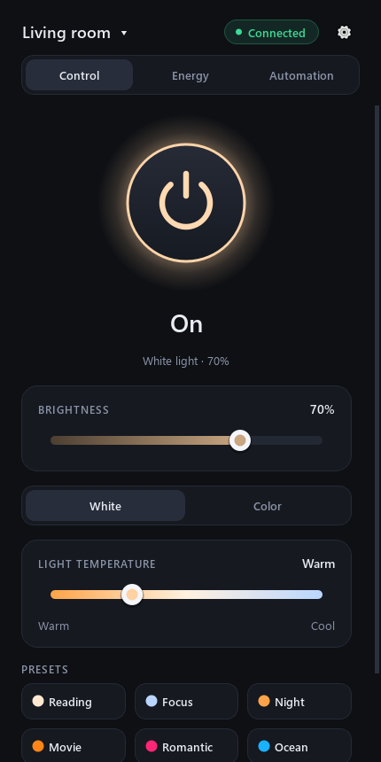
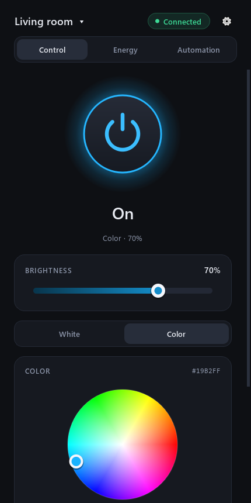
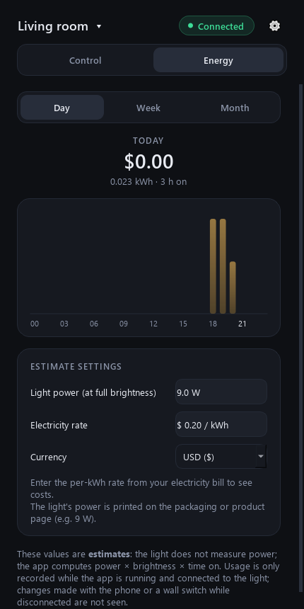
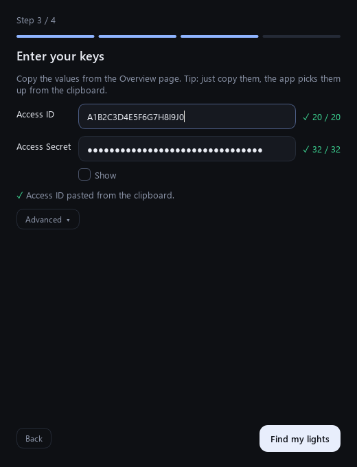
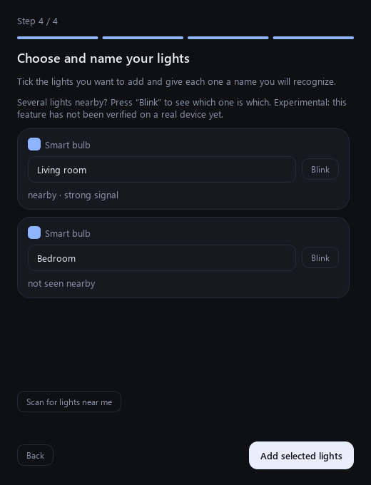
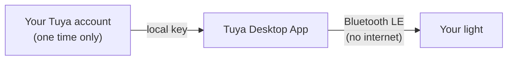

# Tuya Desktop App

**English** · [Türkçe](README.tr.md)

[](https://github.com/nevzatius/tuya-desktop-app/actions/workflows/ci.yml)
[](LICENSE)
[](https://github.com/nevzatius/tuya-desktop-app/releases)

Control your Tuya / Smart Life lights from your Windows PC over Bluetooth, with no cloud and no internet once it is set up.

> **Unofficial project.** It is not affiliated with, endorsed by or connected to Tuya Inc. "Tuya" and "Smart Life" are trademarks of their respective owners. The software is provided as is (see [LICENSE](LICENSE)).

<p align="center">
  
  
  
</p>

## Quick start

1. **Download** `TuyaDesktopApp-Setup-<version>.exe` from the [Releases](https://github.com/nevzatius/tuya-desktop-app/releases) page.
2. **Run it.** If Windows SmartScreen says "Windows protected your PC", click **More info → Run anyway**. The warning appears because the app is not code-signed yet (a signing certificate costs money), not because something is wrong.
3. **Follow the first-run wizard** to connect your light. It takes about 10 minutes, once.

> ### Why does the app need a key?
> A Tuya light only talks to devices that know its **local key**, and only the Tuya account the light belongs to can provide it. The wizard walks you through getting that key from your own free Tuya developer account, step by step. You do this **once**; afterwards the app talks to the light directly over Bluetooth and works **without internet**. Don't skip it: without the key the light cannot be controlled.

<p align="center">
  
  
</p>

## Features

- On/off, brightness, white temperature, colour and six presets (Reading, Focus, Night, Movie, Romantic, Ocean).
- Several lights; switch, rename or remove them from the title menu.
- System tray: closing the window keeps the app running; turn the light on/off from the tray. Reconnects by itself.
- Guided setup wizard with clipboard detection, live validation and "Try again" recovery buttons.
- Scan for nearby lights with signal strength, and a **Blink** button to tell lights apart (experimental, see [Status](#status)).
- Troubleshooter card for "light not found" and a diagnostic report you can paste into an issue.
- **Estimated** energy use and cost: daily, weekly and monthly.
- English and Turkish interface (language in the ⚙ menu; system language by default).
- Windows installer with Start menu entry, optional desktop shortcut and optional "Start with Windows" (starts in the tray).

## How it works



The setup wizard fetches your light's local key from your own Tuya Cloud project once. After that the app finds the light by Bluetooth, performs the Tuya BLE handshake with that key and sends commands directly. Nothing is sent to any server of this project.

## Status

An honest summary of what has and has not been tried on real hardware:

| Area | Status |
|---|---|
| Bluetooth connection and handshake | **Verified** on a real light (Tuya category `dj`, YX-ZNLD9) with v0.2.0 |
| Commands (on/off, brightness, colour, presets), UI, energy estimates | Covered by automated tests; full end-to-end check on a real light is still ongoing |
| Setup wizard v2 (clipboard detection, nearby scan) | Automated tests only — **not yet verified on a real device** |
| **Blink** button (identify a light) | Experimental — **not yet verified on a real device** |
| **Troubleshooter** card and diagnostic report | Experimental — **not yet verified on a real device** (the report's privacy filter is covered by tests) |
| Windows installer and portable zip | Build scripts and release workflow written; **not yet built and tried by the maintainer** |
| English interface | Automated tests and generated screenshots; not yet reviewed on an English-language Windows |
| Windows 10/11 | Primary target; the UI has had little wide testing on real Windows installs |
| macOS / Linux | Expected to work (Qt + bleak), **not tried** |
| Wi-Fi (local network) control | **Not available yet** (planned) |

## Supported devices

| Device | Status |
|---|---|
| YX-ZNLD9 (Tuya category `dj`) | **Tried**: Bluetooth connection and handshake verified |
| Other standard `dj` lights (v2 command set: `switch_led`=20, `work_mode`=21, `bright_value_v2`=22, `temp_value_v2`=23, `colour_data_v2`=24) | **Expected** to work, untested |
| Other light categories (`dd`, `xdd`, `fwd`, `dc`, `tgq`, `tyndj`, `fsd`) | Listed as "experimental"; may use different commands |
| Wi-Fi-only devices, plugs, other Tuya device types | Not supported |

**Community reports wanted.** Tried it with your light? Please open a [device report](https://github.com/nevzatius/tuya-desktop-app/issues/new?template=device_report.yml) (model, category, what worked) and paste the diagnostic report (⚙ → *Copy diagnostic report*). It contains no keys, IDs or addresses.

## Energy estimate: what it can and cannot tell you

Lights do not measure power. The app estimates: *rated power (W) × brightness × time on*.

- Usage is recorded **only while the app is running and connected** to the light. Changes made with your phone or a wall switch while the app is closed or disconnected are not seen, so numbers lean towards a lower bound.
- Enter the light's rated power (printed on the packaging, e.g. 9 W) and your electricity rate from your bill.
- English interface: the rate starts **empty** and you choose your currency (the default follows your system region). Turkish interface: the default is the EPDK residential tariff (April 2026) and the lira; check your own bill, tariffs change.
- Records are stored locally in `energy.db`, next to your keys.

## Quick access: tray, command line and shortcuts

> **Not yet verified on a real device.** These features are covered by automated tests (including a real Windows `RegisterHotKey` call and a two-process command-line check), but have not been tried with a real light by the maintainer.

- **Tray menu:** right-click the tray icon for a **Presets** submenu (built-in and your own) and **Pause automations / Resume automations**.
- **Command line** (the app must already be running, it can sit in the tray):

```
TuyaDesktopApp.exe --scene "Movie"
TuyaDesktopApp.exe --scene movie
TuyaDesktopApp.exe --power on
TuyaDesktopApp.exe --power off
```

  `--scene` takes a preset name (case-insensitive) or its key (`reading`, `focus`, `night`, `movie`, `romantic`, `ocean`; your own presets by name). The command is handed to the running app over a local channel that only your Windows user can open; the app then sends it to the light over Bluetooth. From source use `python light_app.py --scene "Movie"`.

  | Exit code | Meaning |
  |---|---|
  | `0` | The command was handed to the app |
  | `1` | The app refused it (e.g. no preset with that name; the message lists the available ones) |
  | `2` | The app is not running |
  | `3` | No valid reply from the app |
  | `64` | Wrong command line |

  **Windows Task Scheduler:** create a task, trigger of your choice, action *Start a program*, program `C:\Program Files\Tuya Desktop App\TuyaDesktopApp.exe`, arguments `--scene "Night"`. **Stream Deck** (or any launcher): add a *System → Open* / *Run* action with the same program and arguments. Both only work while the app is running. They do not start it: use *Start with Windows* in the installer so it is already in the tray.
- **Global shortcuts (Windows only):** Open *Presets → Manage…*, pick a preset and press **Shortcut…** (e.g. `Ctrl+Alt+1`). It needs Ctrl, Alt or Win plus a letter, digit or F1-F12, and works everywhere while the app is running. If another app already uses the combination you get an error and the old shortcut is kept. The button is hidden on macOS and Linux.

## Privacy and security

- Your lights' local keys are stored **only on this computer**, in `%APPDATA%\TuyaDesktopApp\devices.json` on Windows (macOS: `~/Library/Application Support/TuyaDesktopApp`, Linux: `~/.config/TuyaDesktopApp`). The file is not encrypted (on Linux/macOS it is readable by your user only). **Do not share it or commit it.**
- The **Access Secret** is used only for the one-time fetch and is never saved. After a successful fetch the app also clears the clipboard if it still holds that secret.
- The app sends no data anywhere. The internet is used only by the setup wizard to talk to Tuya Cloud.
- Logs, error messages and the diagnostic report mask local keys, device IDs, UUIDs, Bluetooth addresses and light names.
- Anyone who knows a light's local key and is within Bluetooth range can control that light.
- Uninstalling keeps your lights and energy history unless you choose to delete them.
- Upgrading from an older version (data folder `OdamdakiIsik`): your lights and energy history are moved automatically on first start.

## Troubleshooting

The app shows a **troubleshooter card** when it cannot find the light. If that does not solve it, use ⚙ → *Copy diagnostic report* and open an [issue](https://github.com/nevzatius/tuya-desktop-app/issues/new/choose).

| Symptom | Likely cause / fix |
|---|---|
| "Light not found" | Bluetooth is off or missing; the **Smart Life app on your phone is connected to the light** (a light accepts one connection at a time: close the app or turn off the phone's Bluetooth); the light is off or too far; another copy of the app or another program is using the light. |
| "The light rejected the key" | The key is outdated (it changes if you remove the light from Smart Life and add it again). Use *Add light…* to fetch it again. |
| "The light did not answer the handshake" | Wrong key, or the device does not support this BLE protocol (not every Wi-Fi + Bluetooth device does). |
| Connects but the light does not react | Open the **Log** button and look for the error. The DP numbers may differ from the standard (see [Supported devices](#supported-devices)); the wizard reads them from the device, and "experimental" devices may use another command set. |
| Wizard: "Access ID or Secret is wrong" | Copy both values again from the project's *Overview* page (characters can get lost when pasting) and make sure they belong to the same project. The data center is tried automatically; you can pick one under *Advanced*. |
| Wizard: "No devices are linked to this project" | In the Tuya project open *Devices → Link App Account* and link your Smart Life account with the QR code. |
| Wizard: "permission" error | In the project's *Service API* tab, make sure the Smart Home related services (e.g. *IoT Core*) are added. |
| Windows SmartScreen warning at install | Expected: the installer is not code-signed yet. *More info → Run anyway*. You can verify the download with `SHA256SUMS.txt` from the release. |
| The app does not show a window at startup | You enabled "Start with Windows": it starts in the system tray. Click the tray icon. |
| I changed the language but nothing happened | The language changes the next time you start the app. |

## Roadmap

- Wi-Fi / local-network control (via tinytuya)
- Smart Life QR sign-in, without a developer account (needs our own Tuya client ID)
- Code-signed installer (removes the SmartScreen warning)
- Energy tab for smart plugs that really measure power
- More light types, scenes and timers; more translations

## Contributing

Bug reports, device reports and pull requests are welcome. See [CONTRIBUTING.md](CONTRIBUTING.md) for how to run the tests and how to add a translation.

## License

[MIT](LICENSE).

## Acknowledgements

[tuya-ble-sdk](https://pypi.org/project/tuya-ble-sdk/) (BLE handshake), [bleak](https://github.com/hbldh/bleak) (Bluetooth), [tinytuya](https://github.com/jasonacox/tinytuya) (Tuya Cloud), [PySide6 / Qt](https://www.qt.io/) (LGPL), [Inno Setup](https://jrsoftware.org/isinfo.php) (installer).

---

## Install from source

Python 3.12 or newer is required.

```
python -m pip install -r requirements.txt
python light_app.py
```

On Windows you can also use `kur.ps1` (creates a virtual environment), then `baslat.bat` to start without a console window, or `kisayol_olustur.ps1` for a desktop shortcut.

Build your own Windows files (PyInstaller; the installer additionally needs [Inno Setup 6](https://jrsoftware.org/isinfo.php)):

```
powershell -ExecutionPolicy Bypass -File .\build_exe.ps1
powershell -ExecutionPolicy Bypass -File .\installer\build_installer.ps1
powershell -ExecutionPolicy Bypass -File .\installer\package_release.ps1
```

## Development

```
python -m pip install -r requirements-dev.txt
python -m pytest tests            # no light needed; Qt runs in offscreen mode
python docs/make_screenshots.py   # regenerates docs/screenshots/en and /tr with sample data
```

Layout: `light_core.py` (BLE session, command encoding), `devices.py` (light store, data-folder migration), `cloud_import.py` (Tuya Cloud import), `energy.py` (estimates), `diagnostics.py` and `privacy.py` (report and masking), `i18n.py` with `locales/` (texts), `ui/` (PySide6 interface), `light_app.py` (entry point), `installer/` (Inno Setup script and build scripts).

The command-line helpers (`app.py`, `get_credentials.py`) are developer tools and are still **Turkish-only**. `python app.py scan` lists nearby Tuya BLE devices; `python app.py -h` shows all commands.
