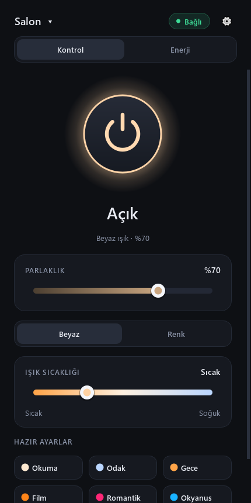
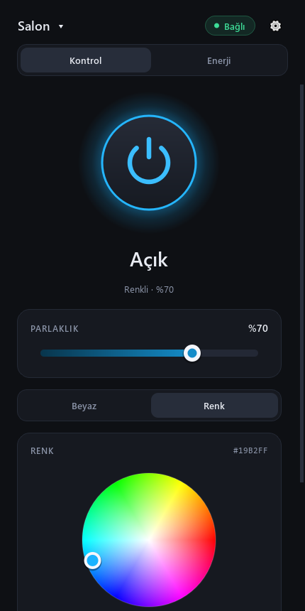
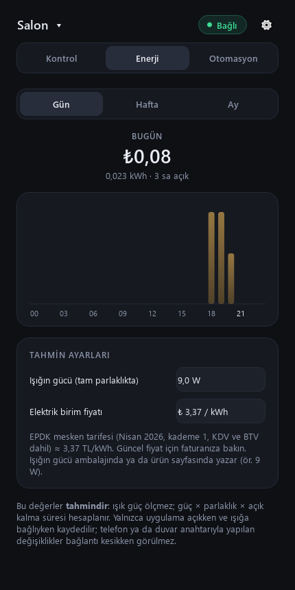
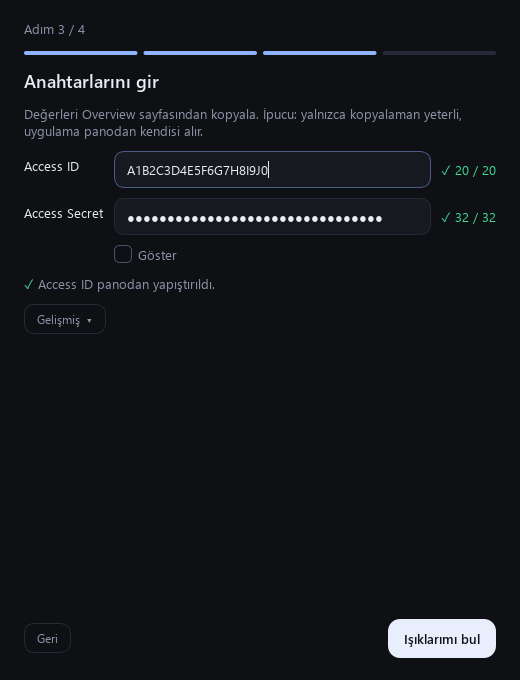
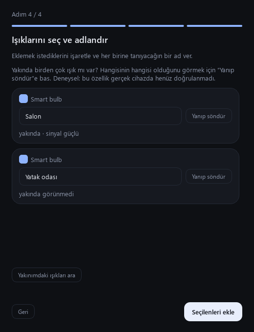
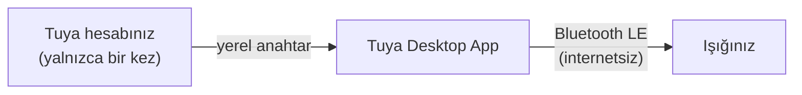
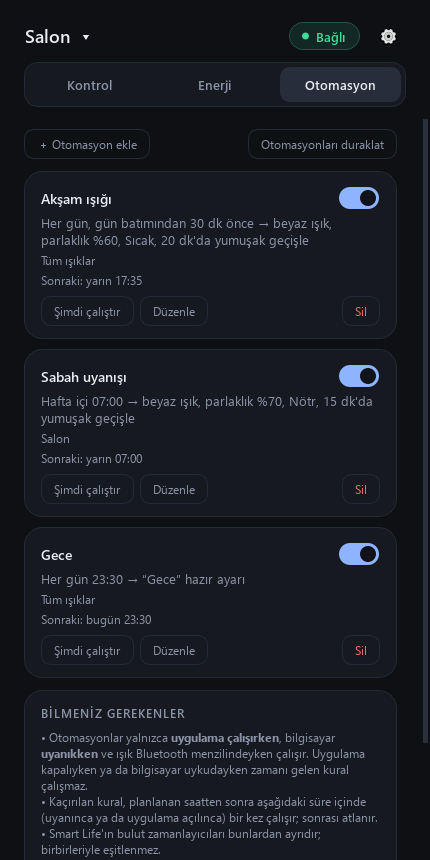

# Tuya Desktop App

[English](README.md) · **Türkçe**

[](https://github.com/nevzatius/tuya-desktop-app/actions/workflows/ci.yml)
[](LICENSE)
[](https://github.com/nevzatius/tuya-desktop-app/releases)

Tuya / Smart Life ışıklarınızı Windows bilgisayarınızdan Bluetooth ile kontrol edin; kurulumdan sonra bulut da internet de gerekmez.

> **Resmi olmayan bir projedir.** Tuya Inc. ile bağlantısı, onayı ya da ortaklığı yoktur. "Tuya" ve "Smart Life" ilgili sahiplerinin ticari markalarıdır. Yazılım olduğu gibi sunulur ([LICENSE](LICENSE)).

<p align="center">
  
  
  
</p>

## Hızlı başlangıç

1. [Sürümler](https://github.com/nevzatius/tuya-desktop-app/releases) sayfasından `TuyaDesktopApp-Setup-<sürüm>.exe` dosyasını **indirin**.
2. **Çalıştırın.** Windows SmartScreen "Windows bilgisayarınızı korudu" derse **Ek bilgi → Yine de çalıştır** deyin. Bu uyarı, uygulama henüz kod imzalı olmadığı için çıkar (imza sertifikası ücretlidir); bir sorun olduğu anlamına gelmez.
3. **İlk açılış sihirbazını izleyin** ve ışığınızı bağlayın. Yaklaşık 10 dakika sürer ve yalnızca bir kez yapılır.

> ### Anahtar neden gerekir?
> Bir Tuya ışığı yalnızca **yerel anahtarını** bilen cihazlarla konuşur ve bu anahtarı yalnızca ışığın bağlı olduğu Tuya hesabı verebilir. Sihirbaz, bu anahtarı kendi ücretsiz Tuya geliştirici hesabınızdan adım adım almanızı sağlar. Bunu **bir kez** yaparsınız; sonrasında uygulama ışıkla doğrudan Bluetooth üzerinden konuşur ve **internetsiz** çalışır. Atlamayın: anahtar olmadan ışık kontrol edilemez.

<p align="center">
  
  
</p>

## Özellikler

- Açma/kapama, parlaklık, beyaz ışık sıcaklığı, renk ve altı yerleşik hazır ayar (Okuma, Odak, Gece, Film, Romantik, Okyanus); ayrıca **kendi hazır ayarlarınız**: şu anki durumu kaydedin, adlandırın, düzenleyin, silin (yerleşikler gizlenebilir).
- Birden çok ışık; başlıktaki menüden değiştirme, yeniden adlandırma, kaldırma.
- Sistem tepsisi: pencereyi kapatınca uygulama çalışmaya devam eder; tepsiden ışığı açıp kapatabilir, hazır ayar uygulayabilir, otomasyonları duraklatabilirsiniz. Bağlantı koparsa kendiliğinden yeniden bağlanır.
- **Otomasyonlar** (deneysel, bkz. [Otomasyonlar](#otomasyonlar)): belirli saatte, gün doğumu/batımında ya da uygulama açılırken; yumuşak geçiş; bir ya da tüm ışıklar.
- **Hızlı erişim** (deneysel, bkz. [Hızlı erişim](#hızlı-erişim-tepsi-komut-satırı-ve-kısayollar)): komut satırı (`--scene`, `--power`) ve Windows'ta genel kısayol tuşları.
- Pano algılama, canlı doğrulama ve "Tekrar dene" düğmeleriyle yönlendirmeli kurulum sihirbazı.
- Çevredeki ışıkları sinyal gücüyle tarama ve ışıkları ayırt etmek için **Yanıp söndür** düğmesi (deneysel, bkz. [Durum](#durum)).
- "Işık bulunamadı" için sorun giderici kart ve sorun bildirirken yapıştırabileceğiniz tanılama raporu.
- **Tahmini** enerji tüketimi ve maliyeti: günlük, haftalık, aylık.
- Türkçe ve İngilizce arayüz (dil ⚙ menüsünde; varsayılan sistem dili).
- Başlat menüsü kısayolu, isteğe bağlı masaüstü kısayolu ve isteğe bağlı "Windows ile başlat" (tepside açılır) seçenekleriyle Windows yükleyicisi.

## Nasıl çalışır?



Kurulum sihirbazı, ışığınızın yerel anahtarını kendi Tuya Cloud projenizden bir kez alır. Sonrasında uygulama ışığı Bluetooth ile bulur, bu anahtarla Tuya BLE el sıkışmasını yapar ve komutları doğrudan gönderir. Bu projenin hiçbir sunucusuna veri gitmez.

## Durum

Gerçek cihazla nelerin denendiğinin, nelerin denenmediğinin dürüst özeti:

| Alan | Durum |
|---|---|
| Bluetooth bağlantısı ve el sıkışma | Gerçek bir ışıkla (Tuya `dj` kategorisi, YX-ZNLD9) v0.2.0 ile **doğrulandı** |
| Komutlar (aç/kapat, parlaklık, renk, hazır ayarlar), arayüz, enerji tahmini | Otomatik testlerle sınandı; gerçek ışıkta uçtan uca doğrulama sürüyor |
| Kurulum sihirbazı v2 (pano algılama, yakın tarama) | Yalnızca otomatik testler — **gerçek cihazda henüz doğrulanmadı** |
| **Yanıp söndür** düğmesi (ışığı tanıma) | Deneysel — **gerçek cihazda henüz doğrulanmadı** |
| **Sorun giderici** kart ve tanılama raporu | Deneysel — **gerçek cihazda henüz doğrulanmadı** (raporun gizlilik filtresi testlerle sınandı) |
| Kendi hazır ayarlarınız (kaydet, düzenle, sil, gizle) | Yalnızca otomatik testler — **gerçek cihazda henüz doğrulanmadı** |
| **Otomasyonlar**: saat ve uygulama açılışı tetikleyicileri, aç/kapat/parlaklık/beyaz/renk/hazır ayar eylemleri, yumuşak geçiş | Yalnızca otomatik testler — **gerçek cihazda henüz doğrulanmadı** |
| Otomasyonlar: **gün doğumu / batımı** tetikleyicileri | Yalnızca bilinen yerlere karşı testler — **gerçek cihazda henüz doğrulanmadı** |
| Otomasyonlar: hedef olarak **birden çok ışık** | Yalnızca otomatik testler — **gerçek cihazda henüz doğrulanmadı** |
| Otomasyonlar: **kaçırılan kural** (uyanma ya da açılıştan sonra tolerans içinde bir kez çalışır) | Yalnızca otomatik testler — **gerçek cihazda henüz doğrulanmadı** |
| Otomasyonlar: **ulaşılamayan ışık** (3 deneme, sonra tepsi bildirimi) | Yalnızca otomatik testler — **gerçek cihazda henüz doğrulanmadı** |
| Tepsi hazır ayarları ve komut satırı (`--scene`, `--power`) | Otomatik testler (iki süreçli komut satırı denemesi dahil) — **gerçek cihazda henüz doğrulanmadı** |
| **Genel kısayol tuşları** | Otomatik testler (gerçek bir Windows `RegisterHotKey` çağrısı dahil) — **gerçek cihazda henüz doğrulanmadı** |
| Windows yükleyicisi | Inno Setup ile derlendi ve geliştiricinin Windows 10 bilgisayarında önceki kurulumun üzerine kuruldu (v0.4.0); uygulama açılıyor ve verilerini koruyor. Release iş akışı ve **taşınabilir zip** **henüz denenmedi** |
| **İngilizce arayüz** | Otomatik testler ve üretilen ekran görüntüleri — İngilizce Windows'ta **henüz doğrulanmadı** |
| Windows 10/11 | Birincil hedef; arayüz gerçek Windows kurulumlarında henüz geniş denenmedi |
| macOS / Linux | Çalışması beklenir (Qt + bleak), **denenmedi** |
| Wi-Fi (yerel ağ) kontrolü | **Henüz yok** (planlı) |

## Desteklenen cihazlar

| Cihaz | Durum |
|---|---|
| YX-ZNLD9 (Tuya `dj` kategorisi) | **Denendi**: Bluetooth bağlantısı ve el sıkışma doğrulandı |
| Diğer standart `dj` ışıkları (v2 komut seti: `switch_led`=20, `work_mode`=21, `bright_value_v2`=22, `temp_value_v2`=23, `colour_data_v2`=24) | Çalışması **beklenir**, denenmedi |
| Diğer ışık kategorileri (`dd`, `xdd`, `fwd`, `dc`, `tgq`, `tyndj`, `fsd`) | "Deneysel" olarak listelenir; farklı komutlar kullanabilir |
| Yalnızca Wi-Fi'lı cihazlar, prizler, diğer Tuya cihaz türleri | Desteklenmiyor |

**Topluluk raporları bekleniyor.** Işığınızla denediniz mi? Lütfen bir [cihaz raporu](https://github.com/nevzatius/tuya-desktop-app/issues/new?template=device_report.yml) açın (model, kategori, neyin çalıştığı) ve tanılama raporunu (⚙ → *Tanılama raporunu kopyala*) yapıştırın. Anahtar, kimlik ya da adres içermez.

## Enerji tahmini: ne söyler, ne söylemez

Işıklar güç ölçmez. Uygulama şunu tahmin eder: *anma gücü (W) × parlaklık × açık kalma süresi*.

- Kullanım **yalnızca uygulama açıkken ve ışığa bağlıyken** kaydedilir. Uygulama kapalıyken ya da bağlantı kesikken telefonla veya duvar anahtarıyla yapılan değişiklikler görülmez; bu yüzden değerler gerçeğin alt sınırına yakındır.
- Işığın anma gücünü (ambalajında yazar, ör. 9 W) ve faturanızdaki elektrik birim fiyatını girin.
- Türkçe arayüz: varsayılan fiyat EPDK mesken tarifesidir (Nisan 2026) ve para birimi liradır; kendi faturanıza bakın, tarifeler değişir. İngilizce arayüz: fiyat **boş** başlar ve para birimini siz seçersiniz (varsayılan sistem bölgenize uyar).
- Kayıtlar yerel olarak, anahtarlarınızın yanındaki `energy.db` dosyasında tutulur.

## Otomasyonlar

<p align="center">
  
</p>

> **Gerçek cihazda henüz doğrulanmadı.** Motor ve sekme otomatik testlerle sınandı (saat hesapları, bilinen konumlarda gün doğumu/batımı, yaz saati geçişleri, tekrar önleme, yeniden deneme, yumuşak geçiş); geliştirici henüz bir kuralın gerçek ışığı zamanında açıp kapattığını izlemedi. İlk günleri deneme olarak görün.

**Otomasyon** sekmesini açıp kural ekleyin. Kural: *ne zaman* → *ne yapılsın* → *hangi ışıklar*:

- **Ne zaman:** seçtiğiniz haftanın günlerinde belirli bir saatte; gün doğumu ya da gün batımında (isterseniz birkaç dakika önce/sonra; konumunuzu enlem ve boylam olarak girersiniz, hesap internetsiz, saf Python ile yapılır); ya da uygulama her açıldığında.
- **Ne yapılsın:** aç, kapat, parlaklık ayarla (kapalı ışığı açmaz), beyaz ışık (parlaklık + sıcaklık), renk ya da hazır ayarlarınızdan birini uygula. İsteğe bağlı olarak 1-120 dakikaya yayılan **yumuşak geçiş**: parlaklık (beyazda sıcaklık da) şu anki değerden hedefe, normal komut yolundan adım adım değişir. Geçiş sırasında ışığa elle dokunursanız geçiş durur.
- **Hangi ışıklar:** hepsi ya da seçtikleriniz. Seçili ışık normal bağlantıdan, diğerleri kısa süreli geçici bir bağlantıdan yönetilir; pencere o ışığa geçmez. Enerji tahmini yalnızca seçili ışık için kaydedilir.
- **Şimdi çalıştır** kuralı hemen dener; anahtar kuralı silmeden kapatır; **Otomasyonları duraklat** (sekme ya da tepsi menüsü) hepsini durdurur.

**Sınırlar, açıkça:**

- Otomasyonlar **yalnızca uygulama çalışırken, bilgisayar uyanıkken ve ışık Bluetooth menzilindeyken** çalışır. Uygulama kapalıyken ya da bilgisayar uykudayken zamanı gelen kural çalışmaz.
- **Kaçırılan kurallar:** uygulama, kuralın saatinden sonra bir tolerans süresi içinde (varsayılan 10 dakika, sekmeden ayarlanır) uyanır ya da açılırsa kural bir kez çalışır; sonrası atlanır. Saatinin hemen ardından oluşturduğunuz ya da açtığınız kural geçmişe dönük çalıştırılmaz. Sistem saatini değiştirmek güvenlidir: aynı kural aynı gün ve dakikada iki kez çalışmaz.
- Ulaşılamayan ışık 3 kez denenir (10 sn ve 30 sn sonra), olmazsa tepsiden bildirim gelir. Başarısız olan kural açık kalır ve bir sonraki sefer yine çalışır.
- **Smart Life'ın bulut zamanlayıcıları ve sahneleri bunlardan ayrıdır**, kurallarla eşitlenmez. Kurallar yalnızca bu uygulamadadır.
- Bluetooth'ta ışıkla aynı anda tek program konuşabilir: telefondaki Smart Life bağlıysa ışığa ulaşılamaz.
- Kurallar ışıklarınızın yanında `automations.json` dosyasında saklanır (dosyada ışıklarınızın cihaz kimlikleri bulunur, anahtarları asla; herkese açık yere yapıştırmayın). Bozuk dosyanın yedeği alınır (`automations.json.bad-<tarih>`) ve uygulama boş listeyle açılır.

## Hızlı erişim: tepsi, komut satırı ve kısayollar

> **Gerçek cihazda henüz doğrulanmadı.** Bu özellikler otomatik testlerle denenmiştir (gerçek bir Windows `RegisterHotKey` çağrısı ve iki süreçli komut satırı denemesi dahil), ancak geliştirici bunları gerçek ışıkla denememiştir.

- **Tepsi menüsü:** tepsi simgesine sağ tıklayın: **Hazır ayarlar** alt menüsü (yerleşik ve kendi ayarlarınız) ve **Otomasyonları duraklat / Otomasyonlara devam et**.
- **Komut satırı** (uygulama zaten çalışıyor olmalı, tepside durabilir):

```
TuyaDesktopApp.exe --scene "Film"
TuyaDesktopApp.exe --scene movie
TuyaDesktopApp.exe --power on
TuyaDesktopApp.exe --power off
```

  `--scene` bir hazır ayarın adını (büyük/küçük harf fark etmez) ya da anahtarını alır (`reading`, `focus`, `night`, `movie`, `romantic`, `ocean`; kendi ayarlarınız adıyla). Komut, yalnızca sizin Windows kullanıcınızın açabildiği yerel bir kanaldan çalışan uygulamaya verilir; uygulama da onu Bluetooth ile ışığa gönderir. Kaynaktan çalıştırırken: `python light_app.py --scene "Film"`.

  | Çıkış kodu | Anlamı |
  |---|---|
  | `0` | Komut uygulamaya iletildi |
  | `1` | Uygulama reddetti (ör. o adda hazır ayar yok; mesaj mevcut ayarları sıralar) |
  | `2` | Uygulama çalışmıyor |
  | `3` | Uygulamadan geçerli yanıt gelmedi |
  | `64` | Komut satırı hatalı |

  **Windows Görev Zamanlayıcı:** istediğiniz tetikleyiciyle bir görev oluşturun, eylem *Program başlat*, program `%LOCALAPPDATA%\Programs\Tuya Desktop App\TuyaDesktopApp.exe` (kullanıcıya özel varsayılan kurulum klasörü; tüm kullanıcılar için kurduysanız `C:\Program Files\Tuya Desktop App`), bağımsız değişkenler `--scene "Gece"`. **Stream Deck** (ya da başka bir başlatıcı): aynı program ve bağımsız değişkenlerle *Sistem → Aç* / çalıştır eylemi ekleyin. İkisi de yalnızca uygulama çalışırken işe yarar; uygulamayı başlatmazlar: yükleyicideki *Windows ile başlat* seçeneğiyle uygulama baştan tepside dursun.
- **Genel kısayol tuşları (yalnızca Windows):** *Hazır ayarlar → Yönet…* bölümünde bir ayarı seçip **Kısayol…** düğmesine basın (ör. `Ctrl+Alt+1`). Ctrl, Alt ya da Win ile bir harf, rakam ya da F1-F12 gerekir; uygulama çalışırken her yerde geçerlidir. Başka bir uygulama aynı kombinasyonu kullanıyorsa hata gösterilir ve eski kısayol korunur. macOS ve Linux'ta düğme gizlidir.

## Gizlilik ve güvenlik

- Işıklarınızın yerel anahtarları **yalnızca bu bilgisayarda** saklanır: Windows'ta `%APPDATA%\TuyaDesktopApp\devices.json` (macOS: `~/Library/Application Support/TuyaDesktopApp`, Linux: `~/.config/TuyaDesktopApp`). Dosya şifrelenmez (Linux/macOS'ta yalnızca kullanıcınız okuyabilir). **Paylaşmayın, depoya yüklemeyin.**
- **Access Secret** yalnızca tek seferlik alma işlemi için kullanılır ve hiçbir yere kaydedilmez. Başarılı alımdan sonra, pano hâlâ o secret'ı tutuyorsa uygulama panoyu da temizler.
- Uygulama hiçbir yere veri göndermez. İnternet yalnızca kurulum sihirbazında Tuya Cloud ile konuşmak için kullanılır.
- Günlük, hata mesajları ve tanılama raporunda yerel anahtar, cihaz kimliği, UUID, Bluetooth adresi ve ışık adları maskelenir.
- Bir ışığın yerel anahtarını bilen ve Bluetooth menzilinde olan biri o ışığı kontrol edebilir.
- Kaldırırken ışıklarınız ve enerji geçmişiniz, silmeyi seçmedikçe korunur.
- Eski bir sürümden (veri klasörü `OdamdakiIsik`) geçiyorsanız ışıklarınız ve enerji geçmişiniz ilk açılışta otomatik taşınır.

## Sorun giderme

Uygulama ışığı bulamadığında bir **sorun giderici kart** gösterir. Çözmezse ⚙ → *Tanılama raporunu kopyala* deyip bir [sorun kaydı](https://github.com/nevzatius/tuya-desktop-app/issues/new/choose) açın.

| Belirti | Olası neden / çözüm |
|---|---|
| "Işık bulunamadı" | Bluetooth kapalı ya da yok; **telefondaki Smart Life ışığa bağlı** (ışığa aynı anda tek bağlantı olur: uygulamayı kapatın ya da telefonun Bluetooth'unu kapatın); ışık kapalı ya da uzakta; uygulamanın başka bir kopyası ya da başka bir program ışığı kullanıyor. |
| "Işık anahtarı reddetti" | Anahtar eski (ışığı Smart Life'tan silip yeniden eklediyseniz değişir). *Işık ekle…* ile yeniden alın. |
| "Işık el sıkışmaya yanıt vermedi" | Anahtar yanlış ya da cihaz bu BLE protokolünü desteklemiyor (hem Wi-Fi hem Bluetooth'lu her cihaz desteklemez). |
| Bağlanıyor ama ışık tepki vermiyor | **Günlük** düğmesini açıp hataya bakın. DP numaraları standarttan farklı olabilir ([Desteklenen cihazlar](#desteklenen-cihazlar)); sihirbaz bunları cihazdan okur, "deneysel" cihazlar farklı komut seti kullanabilir. |
| Sihirbaz: "Access ID veya Secret yanlış" | İki değeri de projenin *Overview* sayfasından yeniden kopyalayın (yapıştırırken karakter kaybolabilir) ve aynı projeye ait olduklarından emin olun. Veri merkezi otomatik denenir; *Gelişmiş* bölümünden seçebilirsiniz. |
| Sihirbaz: "Bu projeye bağlı cihaz bulunamadı" | Tuya projesinde *Devices → Link App Account* ile Smart Life hesabınızı QR kodla bağlayın. |
| Sihirbaz: "yetki" hatası | Projenin *Service API* sekmesinde Smart Home ile ilgili hizmetlerin (ör. *IoT Core*) ekli olduğundan emin olun. |
| Kurulumda Windows SmartScreen uyarısı | Beklenen durum: yükleyici henüz kod imzalı değil. *Ek bilgi → Yine de çalıştır*. İndirdiğinizi sürümdeki `SHA256SUMS.txt` ile doğrulayabilirsiniz. |
| Uygulama açılışta pencere göstermiyor | "Windows ile başlat"ı seçtiniz: sistem tepsisinde açılır. Tepsi simgesine tıklayın. |
| Dili değiştirdim ama bir şey olmadı | Dil, uygulamayı bir sonraki açışınızda değişir. |

## Yol haritası

- Wi-Fi / yerel ağ kontrolü (tinytuya ile)
- Geliştirici hesabı gerektirmeyen Smart Life QR girişi (kendi Tuya istemci kimliğimiz gerekir)
- Kod imzalı yükleyici (SmartScreen uyarısını kaldırır)
- Gerçekten güç ölçen akıllı prizler için enerji sekmesi
- Daha fazla ışık türü; daha fazla çeviri
- Uygulama kapalıyken de çalışan otomasyonlar (arka plan hizmeti)

## Katkıda bulunma

Hata bildirimleri, cihaz raporları ve çekme istekleri (pull request) memnuniyetle karşılanır. Testleri çalıştırma ve çeviri ekleme için [CONTRIBUTING.md](CONTRIBUTING.md) dosyasına bakın.

## Lisans

[MIT](LICENSE).

## Teşekkürler

[tuya-ble-sdk](https://pypi.org/project/tuya-ble-sdk/) (BLE el sıkışması), [bleak](https://github.com/hbldh/bleak) (Bluetooth), [tinytuya](https://github.com/jasonacox/tinytuya) (Tuya Cloud), [PySide6 / Qt](https://www.qt.io/) (LGPL), [Inno Setup](https://jrsoftware.org/isinfo.php) (yükleyici).

---

## Kaynaktan kurulum

Python 3.12 ya da üstü gerekir.

```
python -m pip install -r requirements.txt
python light_app.py
```

Windows'ta ayrıca `kur.ps1` (sanal ortam kurar), ardından konsol penceresi açmadan başlatmak için `baslat.bat` ya da masaüstü kısayolu için `kisayol_olustur.ps1` kullanılabilir.

Kendi Windows dosyalarınızı derlemek için (PyInstaller; yükleyici için ayrıca [Inno Setup 6](https://jrsoftware.org/isinfo.php) gerekir):

```
powershell -ExecutionPolicy Bypass -File .\build_exe.ps1
powershell -ExecutionPolicy Bypass -File .\installer\build_installer.ps1
powershell -ExecutionPolicy Bypass -File .\installer\package_release.ps1
```

## Geliştirme

```
python -m pip install -r requirements-dev.txt
python -m pytest tests            # ışık gerekmez; Qt "offscreen" modunda çalışır
python docs/make_screenshots.py   # docs/screenshots/en ve /tr klasörlerini örnek verilerle yeniden üretir
```

Yapı: `light_core.py` (BLE oturumu, komut kodlama), `devices.py` (ışık deposu, veri klasörü taşıma), `storage.py` (yedekli ortak JSON okuma/yazma), `cloud_import.py` (Tuya Cloud içe aktarma), `energy.py` (tahminler), `automation.py` ve `sun.py` (otomasyon motoru, gün doğumu/batımı), `shortcuts.py` ve `quick_cli.py` (kısayol ve komut satırı çözümleme), `diagnostics.py` ve `privacy.py` (rapor ve maskeleme), `i18n.py` ve `locales/` (metinler), `ui/` (PySide6 arayüzü; otomasyon sekmesi, yerel komut kanalı `ipc.py` ve `hotkeys.py` dahil), `light_app.py` (giriş noktası), `installer/` (Inno Setup betiği ve derleme betikleri).

Komut satırı araçları (`app.py`, `get_credentials.py`) geliştirici araçlarıdır ve hâlâ **yalnızca Türkçedir**. `python app.py scan` çevredeki Tuya BLE cihazlarını listeler; `python app.py -h` tüm komutları gösterir.
